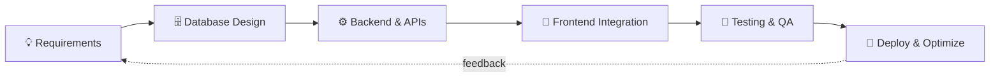

<!-- ═══════════════════════ HEADER ═══════════════════════ -->

 

---

## 👨‍💻 About Me

I'm a **backend-focused developer** who enjoys taking an idea from a blank page to a working product: modelling the data, building the APIs and business logic, wiring up the interface, and then tuning it until it's reliable.

- 🎓 **MCA (Semester III)** at **CMPICA, CHARUSAT**, Changa
- 🧱 Hands-on with **Laravel, PHP, MySQL, MariaDB, REST APIs, React and Bootstrap**
- 🏢 Experience building **ERP systems, database-driven applications, document-processing tools and responsive UIs**
- 🧪 Currently studying **Software Quality Assurance**, which is shaping how I think about testing and reliability
- 🤝 Open to collaborating on **open-source, Laravel/PHP apps, REST API projects and full-stack builds**

> *"Good software isn't just software that works. It's software that stays* ***reliable, maintainable, secure, scalable and fast*** *as it grows."*

---

## 🛠️ Tech Stack

| Layer | Technologies |
|:---:|:---|
| **Backend** |    |
| **Frontend** |      |
| **Database** |   |
| **Tools & Cloud** |      |

---

## 💼 What I Build

<table>
<tr>
<td width="50%" valign="top">

### 🏢 ERP & Business Applications
- Patient and policy management
- Hospital and branch workflows
- Billing and invoice systems
- Payment processing and document management
- Roles, permissions and workflow automation

</td>
<td width="50%" valign="top">

### 🔌 Backend & API Development
- RESTful API design and CRUD operations
- Authentication and authorization
- Request validation and DB transactions
- Error handling and third-party integrations

</td>
</tr>
<tr>
<td width="50%" valign="top">

### 🗄️ Database Engineering
- Relational design and normalization
- Complex SQL: joins, subqueries, aggregations
- Query optimization and indexing
- Data integrity and large-dataset handling

</td>
<td width="50%" valign="top">

### ⚡ Performance & Reliability
- Efficient, index-aware queries
- Scalable backend architecture
- Debugging production issues
- Clean, maintainable, secure code

</td>
</tr>
</table>

---

## 🧭 How I Work

---

## 🔭 Focus Areas

<table>
<tr>
<td width="33%" valign="top">

### 🏗️ Building
- Full-stack web apps
- Laravel and PHP backends
- ERP modules and workflows
- RESTful APIs

</td>
<td width="33%" valign="top">

### 🌱 Learning
- React.js and Node.js
- Firebase and Google Cloud
- System design
- Cloud deployment
- Application security
- AR development with Unity

</td>
<td width="33%" valign="top">

### 🤝 Collaborating On
- Open-source projects
- Laravel/PHP applications
- REST API projects
- Database-driven systems
- Unity/AR experiments

</td>
</tr>
</table>

---

## 📌 Featured Projects

| Project | What it is | Stack |
|:---|:---|:---:|
| 🔐 [**password-manager**](https://github.com/Naitik-Dholakiya/password-manager) | Secure password manager app |  |
| 📄 [**resume-builder**](https://github.com/Naitik-Dholakiya/resume-builder) | Web app for building and exporting resumes |  |
| 🧑‍🎨 [**my-portfolio**](https://github.com/Naitik-Dholakiya/my-portfolio) | Personal portfolio, v2 |  |
| 🌐 [**Portfolio**](https://github.com/Naitik-Dholakiya/Portfolio) | Personal portfolio, v1 |  |
| 🧠 [**Face-Recognition**](https://github.com/Naitik-Dholakiya/Face-Recogination) | Facial recognition project |  |

> 🏢 Much of my backend work (ERP, billing, policy and hospital systems) is built in private, so it isn't listed here. Happy to talk through it.

---

## 📊 GitHub Stats

<b>🏆 Trophies & activity graph</b>

 

---

## 🎯 2026 Goals

- [ ] 🚀 Ship production-ready full-stack applications
- [ ] 🧠 Deepen system design knowledge
- [ ] ☁️ Learn and apply cloud architecture
- [ ] 🔐 Strengthen application security
- [ ] 🤝 Contribute more to open source

---

## 📫 Let's Connect

Have a project, an idea, or an open-source repo that needs a backend hand? I'd love to hear from you.

 

**⭐ If any of my projects helped you, a star means a lot!**

