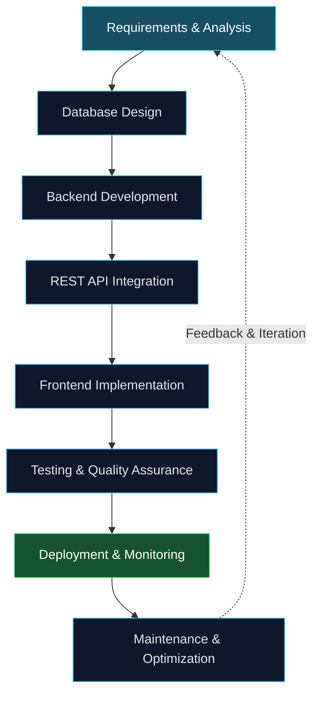

# Naitik Dholakiya

  

  

   

  
  
  
  

    

  
  

---

## About Me

I'm a backend-focused software developer passionate about designing reliable applications, building RESTful APIs, and developing database-driven business solutions.

My experience includes working with **Laravel, PHP, MySQL, and MariaDB** to develop backend functionality for ERP systems, billing workflows, document-processing tools, and business applications. I also work with frontend technologies to integrate APIs and deliver complete, usable solutions.

- 🎓 Pursuing an MCA at **CMPICA, CHARUSAT, Changa, Gujarat**.
- 💻 Focused on backend development, API design, and database engineering.
- 🏢 Experienced in ERP workflows, business logic, billing systems, and application integration.
- 🔌 Comfortable with REST APIs, SQL queries, data validation, and debugging.
- 🌱 Continuously improving my knowledge of software architecture, quality assurance, and application security.
- 🤝 Interested in collaborating on meaningful open-source projects and practical software solutions.

> **My engineering philosophy:** Build software that is reliable, maintainable, secure, and designed to grow.

## Technical Skills

### Backend Development

### Frontend Development

### Databases

### Tools & Platforms

### Core Competencies

| Area | Skills |
|:---|:---|
| **Backend Engineering** | PHP, Laravel, REST API development, CRUD operations, request validation, business logic |
| **Database Engineering** | MySQL, MariaDB, SQL joins, subqueries, normalization, indexing, data integrity |
| **Frontend Integration** | JavaScript, React, Bootstrap, HTML5, CSS3, API integration |
| **Application Security** | Authentication, authorization, input validation, secure handling of application data |
| **Software Quality** | Debugging, error handling, testing fundamentals, maintainable code |
| **Development Tools** | Git, GitHub, Postman, VS Code, Docker, database management tools |

## What I Build

<table>
  <tr>
    <td width="50%" valign="top">
      <h3>Enterprise Applications</h3>
      <ul>
        <li>ERP modules and business workflows</li>
        <li>Hospital and policy management systems</li>
        <li>Customer and billing management</li>
        <li>Document-processing workflows</li>
        <li>Role-based application functionality</li>
      </ul>
    </td>
    <td width="50%" valign="top">
      <h3>Backend & API Systems</h3>
      <ul>
        <li>RESTful API architecture</li>
        <li>Authentication and authorization</li>
        <li>Request validation and error handling</li>
        <li>Third-party service integrations</li>
        <li>Frontend-to-backend integration</li>
      </ul>
    </td>
  </tr>
  <tr>
    <td width="50%" valign="top">
      <h3>Database Solutions</h3>
      <ul>
        <li>Relational database design</li>
        <li>Complex SQL queries and joins</li>
        <li>Data consistency and integrity</li>
        <li>Query optimization fundamentals</li>
        <li>Database-driven business logic</li>
      </ul>
    </td>
    <td width="50%" valign="top">
      <h3>Engineering & Reliability</h3>
      <ul>
        <li>Production issue investigation</li>
        <li>Maintainable application structure</li>
        <li>Validation and exception handling</li>
        <li>Testing and quality improvement</li>
        <li>Performance-aware implementation</li>
      </ul>
    </td>
  </tr>
</table>

## Featured Projects

A selection of projects that demonstrate my interest in security, productivity, and web application development.

<table>
  <tr>
    <td width="50%" valign="top">
      <h3><a href="https://github.com/Naitik-Dholakiya/password-manager">Password Manager</a></h3>
      
A web application focused on managing password-related information and exploring secure application design.

      

      <a href="https://github.com/Naitik-Dholakiya/password-manager">View repository →</a>
    </td>
    <td width="50%" valign="top">
      <h3><a href="https://github.com/Naitik-Dholakiya/resume-builder">Resume Builder</a></h3>
      
A web application for creating and exporting structured resumes with an emphasis on usability and presentation.

      

      <a href="https://github.com/Naitik-Dholakiya/resume-builder">View repository →</a>
    </td>
  </tr>
  <tr>
    <td width="50%" valign="top">
      <h3><a href="https://github.com/Naitik-Dholakiya/my-portfolio">Personal Portfolio</a></h3>
      
My portfolio website showcasing my developer profile, technical interests, and selected work.

      

      <a href="https://github.com/Naitik-Dholakiya/my-portfolio">View repository →</a>
    </td>
    <td width="50%" valign="top">
      <h3><a href="https://github.com/Naitik-Dholakiya/Portfolio">Portfolio — Original Version</a></h3>
      
An earlier iteration of my personal portfolio and a record of my frontend development journey.

      

      <a href="https://github.com/Naitik-Dholakiya/Portfolio">View repository →</a>
    </td>
  </tr>
  <tr>
    <td colspan="2" valign="top">
      <h3><a href="https://github.com/Naitik-Dholakiya/Face-Recogination">Face Recognition</a></h3>
      
A computer vision project exploring facial recognition using Python.

      

      <a href="https://github.com/Naitik-Dholakiya/Face-Recogination">View repository →</a>
    </td>
  </tr>
</table>

*Some professional projects involving ERP, billing, hospital workflows, and business systems are maintained in private repositories and are therefore not listed here.*

## Development Workflow

I approach application development as an iterative engineering process, from understanding the requirements to testing and ongoing improvement.

## Currently Focusing On

- **Backend engineering:** Improving Laravel architecture, API design, and maintainability.
- **Database engineering:** Writing efficient SQL and building reliable relational data models.
- **Full-stack development:** Strengthening React skills and frontend-to-backend integration.
- **Software quality:** Learning testing strategies, verification techniques, and defect prevention.
- **Application security:** Deepening knowledge of authentication, authorization, and secure coding practices.
- **Cloud & deployment:** Building practical experience with Docker and cloud platforms.

## GitHub Statistics

  
  

   

  

  
<strong>View GitHub trophies and contribution activity</strong>

   

  

    
      
    
  

*GitHub statistics and language breakdowns are generated dynamically and may not represent all of my work, especially private or externally hosted projects.*

## Let's Connect

I'm always interested in connecting with developers, exchanging ideas, and collaborating on useful software projects.

Whether it's backend development, Laravel applications, REST APIs, database engineering, or full-stack web development, feel free to reach out.

  
  
  

    

  **Thanks for visiting my profile. Let's build something meaningful.**

  

